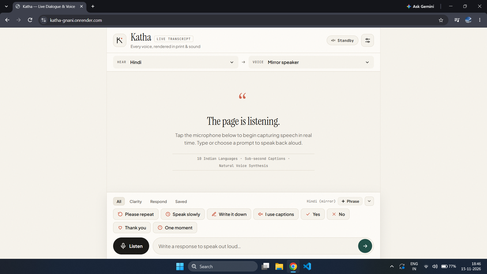

# Katha

**Live captions and one-tap spoken replies for deaf and hard-of-hearing people, in 10 languages.**
Built for the Great Indian AI Internship Challenge by Gnani AI, using Gnani Prisma (speech-to-text) and Gnani Timbre (text-to-speech).

- **Live demo:** https://YOUR-SERVICE-NAME.onrender.com *(free hosting: the first load can take up to a minute)*
- **Demo video / post:** PASTE-YOUR-LINKEDIN-POST-LINK



## The problem

At a hospital counter, a bank, or a railway enquiry desk, a deaf or hard-of-hearing person often has to ask someone to write things down. Captioning tools exist, but they tend to struggle with Indian languages and with code-mixed speech like Hinglish.

Katha listens to the speech around you and shows it as large, easy-to-read text. You can answer without speaking: type a reply or tap a quick reply, and Katha says it out loud.

## What it does

- **Live captions.** Speech is streamed to Gnani Prisma and shown as large text with a timestamp and the detected language.
- **Spoken replies.** Type a reply or tap a quick reply, and Gnani Timbre speaks it aloud.
- **Choose both languages.** *Hear* sets the language you expect to listen to. *Voice* sets the language of your spoken reply, or mirrors the last speaker.
- **Quick replies.** Ready-made phrases such as "Please repeat", "Speak slowly" and "Write it down", in 10 languages. You can also save your own phrases (stored in your browser).
- **Transcript export.** Download the conversation as a text file, with the time of every message.
- **Reading options.** Adjustable text size, and three themes: Warm Paper, Night Ink and High Contrast.
- **Crowded environment filter (experimental).** Makes the speech detector stricter so background sound is less likely to be treated as speech.

Languages: Hindi, English, Punjabi, Gujarati, Marathi, Bengali, Tamil, Telugu, Kannada and Malayalam (nine Indian languages plus English), including Hinglish code-mixing.

## How it works

```
Browser microphone
  -> AudioWorklet (16-bit PCM, 1,024-byte frames)
  -> WebSocket to the Express server
  -> Gnani Prisma v3.0 streaming speech-to-text
  -> transcript JSON back to the page

Typed reply or quick reply
  -> POST /api/tts on the Express server
  -> Gnani Timbre v3.0 text-to-speech (v2.5 as a fallback)
  -> audio played in the browser
```

The Gnani API key stays on the server. The browser never sees it.

## Gnani models used

| Model | Used for |
|---|---|
| Prisma v3.0 | Streaming speech-to-text over WebSocket |
| Timbre v3.0 (v2.5 fallback) | Text-to-speech for spoken replies |

## Run it locally

You need Node.js 18 or newer and a Gnani API key from https://app.gnani.ai/voice.

```bash
git clone https://github.com/ishan-did-it/Katha-gnani.git
cd Katha-gnani
npm install
```

Create a file named `.env` in the project root:

```
GNANI_API_KEY=your_key_here
```

Then start the server and open http://localhost:3000:

```bash
npm start
```

The microphone only works on `localhost` or over HTTPS.

## Deploy (Render)

1. Create a new **Web Service** from this repo.
2. Build command: `npm install`. Start command: `npm start`.
3. Add an environment variable `GNANI_API_KEY` with your key.

## Testing so far

These are small, informal tests, not a benchmark. Reference sentences were written in advance and each caption was scored by comparing it with the intended sentence. They have not been reviewed by a native speaker. Real voices were used, and the speaker was not a native speaker of the language.

| Language | Condition | Result | Notes |
|---|---|---|---|
| Bengali | Quiet room | 5/5 | English words stay in Latin letters |
| Bengali | Street noise played from a TV | 4/5 | Missed a word |
| Hindi / Hinglish | Quiet room | 5/5 | Very Accurate |
| Hindi / Hinglish | Street noise played from a TV | 5/5 | The model is strongest in this language |
| Punjabi, Gujarati, Telugu | Quiet room | 5/5 | Satisfactory |
| Punjabi, Gujarati, Telugu |  Street noise played from a TV | 5/5 | I believe i used very simple sentences due to absence of native speaker |

## Known limitations

- Captions appear after each pause, one sentence at a time. They are not word-by-word.
- Background voices (a TV, other people) can be transcribed as if they were the speaker. In noisy places it can also produce a fluent but wrong sentence, so check anything important.
- Everything is one stream. It does not separate speakers.
- The quick-reply translations were written with AI help and have not been reviewed by native speakers.
- There is no translation between languages yet.
- On the free host, the server sleeps when idle and the first request can be slow.

## Privacy

Audio is streamed through this app's server to Gnani for transcription, and typed replies are sent to Gnani for speech. This app does not store audio or transcripts on its server. The conversation is kept in your browser until you export or clear it, and your settings and saved phrases stay in your browser. Gnani's own data handling applies to what it receives. For a demo, use made-up details and not real personal information.

## Roadmap

- Translation between languages (for example a Hinglish speaker and a Tamil reader), with a preview before anything is spoken.
- Native-speaker review of all quick replies.
- Situation packs for hospital, bank and railway counters.
- Speaker separation and word-by-word captions, if the API supports them.
- An installable mobile app (PWA).

## Tech

Node.js, Express 5, `ws`, vanilla JavaScript, the Web Audio API (AudioWorklet), and CSS.

```
server.js              Express server, WebSocket proxy, TTS route
public/index.html      page
public/app.js          captions, replies, quick replies, export
public/style.css       themes and layout
public/pcm-worklet.js  microphone audio to PCM frames
```

## Acknowledgements

Thanks to Gnani AI for the Prisma and Timbre models and for the challenge.
